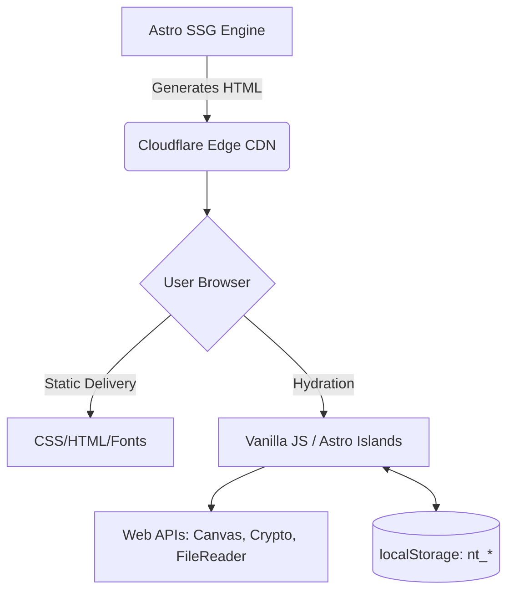

# NumanX Tools — Ultimate Architecture & Expansion Roadmap

> **Mission Statement**: A privacy-first, client-side ecosystem of 100+ free online tools designed for creators, students, and engineers. Every tool executes entirely in the browser — guaranteeing zero server uploads, absolute data privacy, and instantaneous performance.

---

## 1. Technical Master Stack

| Layer | Primary Technology | Version | Architectural Purpose & Constraints |
| --- | --- | --- | --- |
| **Framework** | [Astro](https://astro.build) | ^6.4.2 | Static Site Generation (SSG) with zero-JS by default. Islands Architecture used strictly for interactive components (`client:idle`). |
| **Styling** | [Tailwind CSS](https://tailwindcss.com) | ^4.3.0 | Utility-first styling via Vite integration. Strictly decoupled from component logic. |
| **State Layer** | Vanilla JS + DOM | – | Minimal dependency footprint. No heavy frameworks (React/Vue) unless specifically required for complex tools (e.g., PDF manipulation). |
| **Persistence** | `localStorage` | – | Client-side tracking using the `nt_` prefix namespace (favorites, usage history). |
| **Graphics** | Canvas API / SVG | – | In-browser image processing, cropping, and dynamic generation. |
| **Deployment** | Cloudflare Pages | – | Global CDN edge caching. Instant cache invalidation via automated CI/CD. |

### 1.1 Strict Constraints Matrix
- **No Backend APIs:** Under no circumstances should user data be transmitted to a server for processing.
- **Maximum Time-to-Interactive (TTI):** < 1.5s on a 3G mobile connection.
- **Dependency Budget:** Third-party npm packages must be < 50KB gzipped unless explicitly approved for heavy tools (like OCR or PDF-lib).

---

## 2. Platform Architecture Topology

---

## 3. The 4-Phase Scale Roadmap (From 55 to 200 Tools)

### ✅ Phase 1 & 2: Foundation & Initial Scale (Current State)
- **Status:** COMPLETED.
- **Milestones Achieved:**
  - Deployed the unified Design System (`MainLayout`, `ToolHeader`).
  - Implemented 55+ static tool routes (`/tools/[category]/[slug].astro`).
  - Integrated `localStorage` state management for Favorites and Search History.
  - Deployed global SEO metadata components (`AppSEO.astro`) and automated XML sitemaps.

### 🟡 Phase 3: The Content & Creator Ecosystem (Months 3-6)
- **Goal:** Reach 50,000 MAU (Monthly Active Users).
- **Deliverables:**
  - **Tool Expansion:** Launch 20+ "Creator" tools (Social media caption generators, YouTube tag extractors).
  - **Content Clustering:** Deploy 50+ blog articles structured as "Spokes" linking to tool "Hubs".
  - **Programmatic SEO:** Implement localized tool pages via Astro's `getStaticPaths` (e.g., `/tools/uk/age-calculator`).
  - **Monetization V1:** Integrate unobtrusive AdSense `AdSlot` components inside tool padding areas.

### 🔴 Phase 4: Advanced Web Capabilities (Months 6-9)
- **Goal:** Reach 100,000 MAU.
- **Deliverables:**
  - **PDF Manipulation Suite:** Integrate `pdf-lib` via web workers to allow client-side PDF merging, splitting, and compression without blocking the main thread.
  - **In-Browser OCR:** Implement `Tesseract.js` via lazy-loaded WebAssembly chunks for Image-to-Text conversion.
  - **Offline PWA Capability:** Transition from purely static to a Progressive Web App (PWA) using Service Workers to allow users to run all 100+ tools offline.

### 🟣 Phase 5: The "NumanX Pro" Paradigm (Months 9-12)
- **Goal:** Introduce recurring revenue (MRR).
- **Deliverables:**
  - **User Accounts:** Integrate Firebase Auth or Supabase for cross-device syncing of Favorites and custom tool workflows.
  - **Pro Tier Features:** Introduce gated premium features (e.g., batch processing 50 images at once, removing watermarks on specific advanced outputs).
  - **API as a Service:** Package the core logic of the most popular tools into a RESTful API for developers to consume on a freemium model.

---

## 4. Database & Storage Architecture (Client-Side)

### The `nt_` Namespace Protocol
All user data is strictly stored in `localStorage` to ensure privacy.

| Key | Data Structure | Pruning Strategy | Purpose |
| --- | --- | --- | --- |
| `nt_favorites` | `string[]` | None | Stores tool slugs bookmarked by the user. |
| `nt_recently_used` | `string[]` | LIFO (Max length: 20) | Populates the homepage "Recent" section. |
| `nt_search_history` | `string[]` | LIFO (Max length: 10) | Populates the search modal suggestions. |
| `nt_tool_usage` | `Record<string, number>` | None | Analytics: Tracks how many times a user uses a specific tool. |

*(Note: In Phase 5, this schema will be migrated to an IndexedDB wrapper for complex sync capabilities.)*

---

## 5. Deployment & Edge Caching (High-Level)
- **CI/CD Pipeline:** GitHub Actions automatically triggers `npm run build` on pushes to `main`.
- **Cache Invalidation:** Cloudflare automatically invalidates edge nodes upon successful deployment.
- **Asset Hashing:** Astro generates unique hashes for all CSS/JS assets (e.g., `_astro/index.a1b2c3d4.css`), allowing for aggressive 1-year caching headers on the CDN edge.
