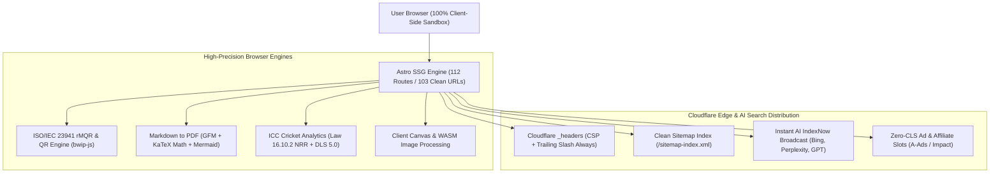

# 🌌 NumanX Tools Hub — Master System Registry & Architecture Showcase

[-F59E0B)](#)

**High-Performance, Privacy-First Browser Utilities with Zero Server Latency**  
*Built for creators, developers, cricket analysts, and everyday internet users.*

[Explore Live Production Platform](https://numanx-tools.pages.dev) • [View Architecture](#-technical-architecture--feature-showcase) • [Developer Setup](#-quick-start-developer-commands)

---

## 🧭 Master Playbook Registry (The 11 Pillars)

NumanX Tools Hub operates on a comprehensive documentation and playbook infrastructure. Access the specialized master playbooks below:

### 🏗️ 1. Architecture & Vision
- 📖 **[PROJECT.md](./PROJECT.md)** — Executive vision, competitive moat (zero-server execution vs. server-side SaaS competitors), and god-tier glassmorphism UI psychology.
- 🗺️ **[PROJECT_ROADMAP.md](./PROJECT_ROADMAP.md)** — 5-Phase scaling roadmap from 55 tools to a full developer ecosystem with Web APIs and pro features.
- 🛠️ **[TOOL-ROADMAP.md](./TOOL-ROADMAP.md)** — Strict technical specifications, browser API constraints, and client-side processing boundaries.
- 🧩 **[COMPONENT_SYSTEM.md](./COMPONENT_SYSTEM.md)** — Exhaustive design system matrix, Tailwind utility classes for 3-tier glassmorphism, and responsive UI components.

### 🚀 2. Launch & Go-To-Market (GTM)
- 🚀 **[LAUNCH-README.md](./LAUNCH-README.md)** — 24-hour Launch Day playbook with ready-to-post copy for Product Hunt, Reddit, and Twitter/X threads.
- 📱 **[SOCIAL-MEDIA-PLAYBOOK.md](./SOCIAL-MEDIA-PLAYBOOK.md)** — Short-form video strategy, viral TikTok/Reels hooks, and organic acquisition funnels.

### 📈 3. Search Engine Dominance & Indexing
- 🔍 **[SEO-ROADMAP.md](./SEO-ROADMAP.md)** — Hub-and-spoke internal linking model, programmatic SEO (pSEO), and backlink acquisition widgets.
- 🤖 **[GSC-INDEXING-PLAYBOOK.md](./GSC-INDEXING-PLAYBOOK.md)** — Google Search Console troubleshooting matrix, crawl unfreezing protocols, and validation workflows.
- 📋 **[indexing-pages.md](./indexing-pages.md)** — Submission ledger and URL verification tracker.

### 💰 4. Monetization & Operations
- 💸 **[ADSENSE-MONETIZATION-PLAYBOOK.md](./ADSENSE-MONETIZATION-PLAYBOOK.md)** — Zero-CLS monetization architecture, responsive fallback slots, and ethical advertising integration.
- ☁️ **[DEPLOYMENT.md](./DEPLOYMENT.md)** — Cloudflare Pages CI/CD pipeline, edge headers, CSP rules, and zero-downtime rollback runbooks.

---

## 🏛️ Technical Architecture & Feature Showcase

### 1. 🔲 ISO/IEC 23941 Rectangular Micro QR (rMQR) Engine
- **Ultra-Compact Barcode Strips**: Generates rectangular Micro QR codes from **R7x43 up to R17x139** for slender labels, medical vials, PCB edges, and narrow merchandise.
- **Auto-Fit Sizing Matrix**: Dynamically computes the most compact valid ISO rectangular matrix based on input text length and chosen error correction tier.
- **Multi-Format Vector Export**: Pure client-side generation of high-DPI PNGs and crisp vector SVGs via `bwip-js/browser`.

### 2. 📄 Client-Side Markdown to PDF Converter (`/tools/markdown-to-pdf/`)
- **Mathematical Typography**: Built-in **KaTeX** math engine renders inline `$E = mc^2$` and block `$$\int f(x) dx$$` formulas with publishing-grade typography.
- **Vector Diagrams**: Embeds **Mermaid.js** diagrams (`flowchart`, `sequenceDiagram`, `stateDiagram`) rendered directly into the PDF preview.
- **Enterprise Print Styles**: Native `@media print` CSS engine with custom margin controls, A4 / US Letter presets, page break inserters (`

`), and zero server transmission.

### 3. 🏏 ICC Cricket Analytics Suite (`/tools/net-run-rate-calculator/`)
- **ICC Law 16.10.2 All-Out Enforcement**: Accurately handles the all-out rule by automatically counting the team's full allotted match quota (e.g., 20.0 or 50.0 overs) rather than fraction overs.
- **Playoff Target & Chase Solver**: Calculates the exact overs threshold or run margin required to overtake a rival's tournament Net Run Rate.
- **Duckworth-Lewis-Stern (DLS) Target Engine**: Calculates revised targets, par scores, and resource percentages ($R_1, R_2$) using standard exponential decay curves ($Z_0 = 1.25, b = 0.045$).
- **Viral Shorts Stat Card Exporter**: Generates custom 1080×1920 mobile story and reel stat cards rendered via HTML5 Canvas with 1-click PNG download.

### 4. 🌌 8,000 Particle Three.js Ambient Visualizer
- **Lightweight WebGL Background**: Custom Three.js particle system with dynamic mouse-parallax, responsive density scaling, and `colorManagement: false` for maximum mobile FPS.
- **Voice-Reactive Events**: Dispatches custom audio pulse events synchronized with the platform's Jarvis assistant state.
- **Core Web Vitals Preserved**: Hardware-accelerated canvas positioned off the main thread with **0.00 Cumulative Layout Shift (CLS)**.

### 5. 📡 Instant Multi-Engine AI Indexing (IndexNow)
- **Instant Crawl Triggers**: Direct integration with the **IndexNow protocol**, alerting Bing, Microsoft Copilot, Perplexity, and OpenAI's SearchBot within seconds of deployment.
- **Zero-Manual Overhead**: Broadcasts clean sitemap URLs directly from `./dist/sitemap-0.xml` via `npm run submit:indexnow`.

---

## ⚡ Quick Start: Developer Commands

Run all platform utilities, testing suites, and build scripts from the project root:

| Command | Action | Description |
| :--- | :--- | :--- |
| `npm install` | Dependencies | Installs Astro 6, Tailwind v4, Vitest, and Web API dependencies |
| `npm run dev` | Local Server | Starts Vite dev server at `http://localhost:3000` |
| `npm test` | Unit Tests | Executes the **36/36 Vitest suite** (ICC NRR, DLS, and utils) |
| `npm run audit` | Site Audit | Runs pre-build audit across 186+ source files and 69 tools |
| `npm run build` | SSG Compile | Compiles **112 static pages** and 103 clean sitemap URLs to `./dist/` |
| `npm run preview` | Edge Preview | Previews production build with local directory routing |
| `npm run submit:indexnow` | AI IndexNow | Broadcasts newly built sitemap URLs to IndexNow network |

---

## 📊 Live Deployment & Search Console Cutover

For step-by-step instructions on deploying commits to production, running edge verification, submitting the 103-URL sitemap to Google Search Console, and configuring monetization payouts (A-Ads, Impact, Carbon), refer to:

- 🚀 **[DEPLOYMENT.md](./DEPLOYMENT.md)** — Edge headers and production release protocol.
- 🤖 **[GSC-INDEXING-PLAYBOOK.md](./GSC-INDEXING-PLAYBOOK.md)** — Step-by-step Search Console unfreezing and URL inspection sequences.
- 💸 **[ADSENSE-MONETIZATION-PLAYBOOK.md](./ADSENSE-MONETIZATION-PLAYBOOK.md)** — Monetization slot setup and local payout gateways.

---

## 🔒 Privacy & Architecture Guarantees

1. **Zero Data Retention**: All user files (images, PDFs, documents, passwords) are processed entirely inside the user's browser using HTML5 Canvas, WebCrypto, and WebAssembly.
2. **Canonical Trailing Slashes**: Configured with `trailingSlash: 'always'` and `build.format: 'directory'` to eliminate redirect chains on Cloudflare Pages.
3. **Clean Route Separation**: Internal state pages (`/dashboard/`, `/favorites/`, `/search/`) are protected with `X-Robots-Tag: noindex, follow` to prevent search crawl budget waste.

---

> *"NumanX doesn't just build tools. We build magic that executes instantly in your browser."*
